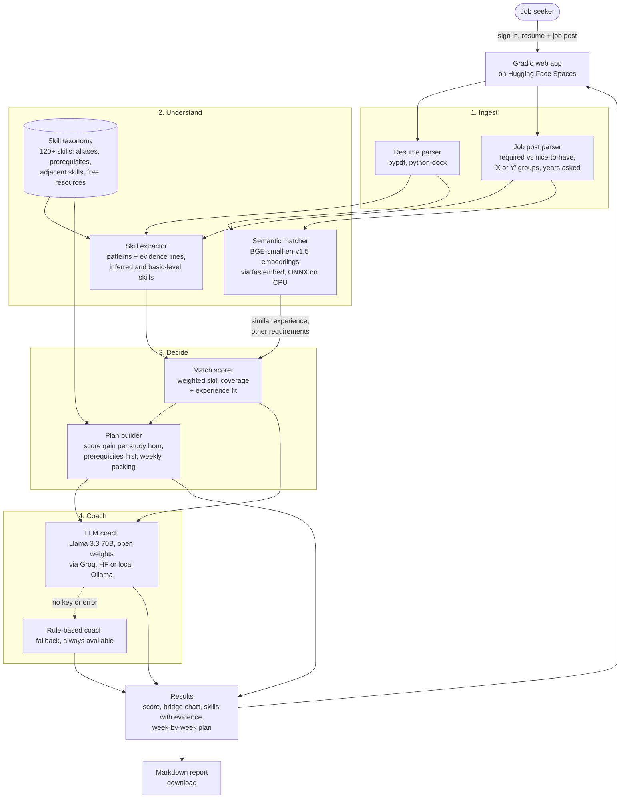

# SkillBridge

SkillBridge compares your resume with a real job post, tells you how well you match, shows exactly
which skills are missing (with the line on your resume that proves each skill you do have), and
builds a week-by-week learning plan that fits the hours you actually have.

**Demo login:** username `demo`, password `SkillBridge2026`

## What it does

1. **Reads both documents.** Upload a PDF, DOCX or TXT resume (or paste it) and paste a job post.
2. **Understands the job post.** Splits required skills from nice-to-haves, spots "X or Y" choices
   ("PyTorch or TensorFlow" is one requirement, not two) and the years of experience asked.
3. **Finds evidence on the resume.** Every matched skill links to the sentence that proves it.
   It infers skills (scikit-learn implies machine learning), flags basic-level ones ("familiar with
   Docker"), and notices transferable ones (Flask makes FastAPI quicker to learn).
4. **Scores the match** out of 100: weighted required skills, nice-to-haves and experience.
5. **Plans the gap.** Orders what to learn by score gained per study hour, puts foundations first
   (Python before FastAPI), packs it into weeks, and adds a free resource and a proof-of-skill
   project for each. The "bridge" bar shows how each skill moves your score.
6. **Coaches you.** An open-weights LLM writes an honest take, sharper resume bullets, a portfolio
   project and interview questions, without inventing experience. A rule-based coach answers if no
   model is configured.
7. **Exports** the whole report as Markdown.

## Open-source stack

| Part | Tool |
| --- | --- |
| Web app | [Gradio](https://github.com/gradio-app/gradio) on Hugging Face Spaces |
| Semantic matching | [BAAI/bge-small-en-v1.5](https://huggingface.co/BAAI/bge-small-en-v1.5) embeddings via [fastembed](https://github.com/qdrant/fastembed) (ONNX, CPU) |
| Resume parsing | [pypdf](https://github.com/py-pdf/pypdf), [python-docx](https://github.com/python-openxml/python-docx) |
| AI coach | Llama 3.3 70B (open weights) through any OpenAI-compatible endpoint: Groq, Hugging Face Inference Providers, or a local Ollama / vLLM server |
| Skill knowledge | Hand-built taxonomy: 121 skills, 600+ aliases, prerequisites, adjacency and free resources |

## Architecture



## Configuration (Space settings, all optional)

| Name | Type | Purpose |
| --- | --- | --- |
| `GROQ_API_KEY` | Secret | Turns on the Llama 3.3 70B coach (free key from console.groq.com) |
| `HF_TOKEN` | Secret | Alternative: use Hugging Face Inference Providers for the coach |
| `LLM_BASE_URL`, `LLM_API_KEY`, `LLM_MODEL` | Secret / variable | Any other OpenAI-compatible server, e.g. Ollama |
| `DEMO_USERNAME`, `DEMO_PASSWORD` | Secret | Change the demo login (defaults: `demo` / `SkillBridge2026`) |
| `DISABLE_EMBEDDINGS` | Variable | Set to `1` to skip the embedding model |

## Run locally

```bash
pip install gradio==6.29.0 -r requirements.txt
python app.py            # http://localhost:7860
python test_engine.py    # quick engine checks
```

## Privacy

Nothing is written to a database. Uploaded files and generated reports are temporary and deleted
within an hour. When an LLM key is configured, the coach sends the resume and job text to that model
provider to write the notes.

## Limits

The taxonomy covers tech, data and AI roles. Hours and scores are estimates meant to guide a plan,
not a hiring decision.
